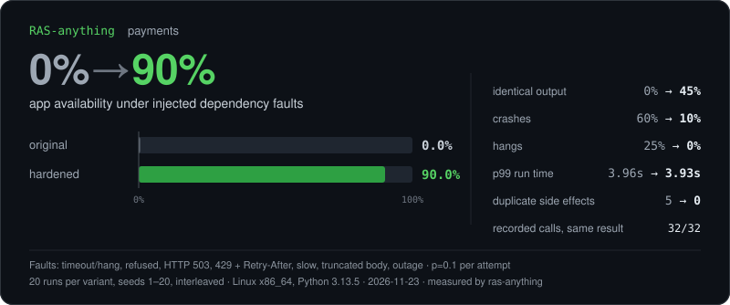

<p align="center"><b>Don't rewrite it for reliability. Harden the 5% that breaks.</b></p>

<p align="center">
  
  
  
  
  
  <a href="LICENSE"></a>
</p>

Most outages in small services start at the boundary: an HTTP call with no timeout that hangs, a
transient 503 that becomes a crash, a retried POST that charges the card twice, an
`except Exception: return None` that turns an outage into silently wrong data. Usually a few
functions cause almost all of it.

**ras-anything** finds those functions by running your app under seeded dependency faults. It has
your coding agent harden *only them*, proves on real recorded calls that the happy path is unchanged
and that availability went up, then swaps them in. One command, fully reversible.

<p align="center"></p>

## Install

```sh
pipx install git+https://github.com/miles990/ras-anything      # private repo: needs GitHub access
# or, from a clone:
pip install -e .
```

Standard library only, Python 3.10+. Your agent (`claude`, `codex`, or anything that reads a prompt on
stdin) writes the hardened code. Or omit `--agent` to write `TASK.md` + a `hardened.py` stub
and edit `hardened.py` / `hardened.mjs` yourself.

## Use

```sh
ras-anything go --agent claude -- python app.py
# or
ras-anything go --agent claude -- node app.mjs
```

`go` leaves the verified swap enabled after `bench` + `report`; inspect `RAS-REPORT.md` or run `ras-anything disable <id>` to roll back.

Or step by step:

| command | what it does |
|---|---|
| `scan -- <cmd>` | runs the app clean and under 5 seeded chaos runs; ranks functions by risk × exposure × hardenability |
| `harden [id] [--agent A]` | records up to 500 real calls (args, result, and every dependency request/response, VCR-style), writes `TASK.md` + a language-matched stub (`hardened.py` / `hardened.mjs`), runs your agent |
| `verify [id]` | replays the recorded calls with no network on a virtual clock: happy path first, then a fault matrix, original vs hardened |
| `enable` / `disable [id]` | swaps the hardened function in or out (one marked block, removed byte for byte) |
| `bench [-- <cmd>]` | whole-app runs under live seeded chaos, original vs hardened interleaved, same seed per pair |
| `report` | `RAS-REPORT.md` + `ras-card.svg` for your PR, with measured numbers only |
| `status` · `doctor` | where you are and what's next · checks Python, agents on PATH, git, `.ras/` |

A scan looks like this (examples/payments):

```text
  #  function                calls  dep  risk  exposure  chaos fail  score  verdict
  1  billing.charge             16   16  0.84       48%         1/1   40.7  ✓ harden it
     app failed in 1/1 chaos runs that hit it (wrong 1) · retries a POST with no Idempotency-Key ·
     `except Exception: time.sleep(0.5)` swallows errors · no logging on the failure path
  2  billing.render_receipt     16   16  0.82       48%         4/4   39.6  ✓ harden it
     app failed in 4/4 chaos runs that hit it (crash 3, hang 1) · subprocess.run() without timeout ·
     no retry on transient errors · no logging on the failure path
```

## Proof, not vibes

`verify` replays every recorded call twice per scenario, once against the original and once against
the hardened function. Dependency answers come from the recording, so nothing touches the network.
Time is virtual: timeouts, backoff and `Retry-After` cost no wall time and are measured exactly. Each
call is classified as **ok** (equal to the recorded result), **degraded** (equal to the fallback the
hardened module declares in `RAS_FALLBACK`, in a call where a dependency request was *seen* to fail and
never got a good answer), **wrong** (any other value: silent bad data), **error**
(an exception within budget) or **hang** (blocked with no timeout, or over the latency budget).
Nothing can be enabled until every gate passes:

- happy-path replay: 100% identical (where the original raised, the same exception type)
- no `wrong` results (a fallback returned with no observed boundary failure is wrong, whatever it logs; an earned one must log with a `trace_id`), no new crash types, and no requests the original never made
- no hangs, and p99 latency within the budget (default 5 s per call)
- duplicate non-idempotent side effects ≤ the original's (POST/PUT/PATCH/DELETE that reached the server under different or missing `Idempotency-Key`s)
- availability (ok + degraded) strictly higher than the original's

Hangs raise `ChaosHang`, a `BaseException`, so `except Exception` can't hide one. The test suite
checks that verify **rejects** a version that swallows everything and returns `None` (even with an
unlogged `RAS_FALLBACK`), one that prints a fake `RAS_FALLBACK`/`trace_id` line without a failure, one
that throws a good answer away for the fallback, one that retries a POST without an idempotency key
(including after a GET), and one that changes the happy-path result. Hardened code may import
`ras_anything.runtime` but nothing else of ras-anything. Enable also refuses any `hardened.py` whose
hash differs from the verified one.

When the original double-sends, verify shows you the exact recorded call:

```text
  ! the original double-sends: call #0 ({'id': 'INV-1001', 'customer': 'Acme Co', 'amount_cents': 1500, 'cur… under timeout
    original: POST #0 timeout (reached server), POST #1 ok → 1 duplicate
    hardened: POST #0 timeout, POST #1 ok → 0 duplicates (one Idempotency-Key: charge-INV-1001)
```

`RAS_ANYTHING_DISABLE=1` runs the originals at any time. The enable block also vendors the ~300-line
runtime next to the hardened code, so the app doesn't need ras-anything installed to run.

## Results

Measured on Linux 6.12 x86_64 (8 CPUs), Python 3.13.5 and Node v24.22.1, 2026-11-23 (Asia/Taipei).
The hardened code was written by Claude Code (Opus) through `--agent claude`. Exact commands and
caveats are in each example's `REPRODUCE.md`. Every example runs its own local upstream, offline.

| example | verify: availability under the fault matrix | bench: app availability, 20 seeds | other bench numbers |
|---|---|---|---|
| [weather dashboard](examples/weather) (`fetch_forecast`, urlopen with no timeout) | 32.5% → **100.0%** (120 trials) | 40.0% → **100.0%** | hangs 15% → 0% · p99 run 2.17s → 889ms |
| [billing run](examples/payments) (`charge` naive POST retry + `render_receipt` subprocess) | charge 76.9% → **100.0%** · render 33.1% → **100.0%** (160 trials each) | 0.0% → **90.0%** | identical 0% → 45% · dups 5 → 0 · hangs 25% → 0% · p99 3.96s → 3.93s |
| [evening order run](examples/orders-node) (Node.js: `charge` fetch POST, `getItem` fetch, `shippingQuote` http.get, `printLabel` execFile) | charge 78.3% → **100.0%** · getItem 29.2% → **100.0%** · shippingQuote 39.2% → **100.0%** · printLabel 32.5% → **100.0%** (120 trials each) | 0.0% → **90.0%** | identical 0% → 90% · dups 6 → 0 · crashes 75% → 10% · hangs 15% → 0% · p99 4.13s → 4.62s |

In the billing run, verify counted 38 duplicate charges for the original across its trials and 0 for
the hardened version. The 10% of bench runs that still fail are the ledger read in `app.main` (Python) or the ledger `fetch` in `app.mjs` (Node), which
was not hardened. 45% of the hardened billing runs printed byte-identical output; the rest were
declared-degraded (`PENDING`, with a stable idempotency key for tomorrow's retry). Hardened runs are
sometimes slower at p50, because they wait out faults instead of dying on them.

## Fault model

Faults are injected per dependency attempt. What is intercepted in **Python** (third-party clients only if
your app imports them):

| boundary | scan / bench faults | recorded and replayed by verify |
|---|---|---|
| `urllib.request.urlopen` | all | yes |
| `requests` (`Session.request`) | all | yes |
| `httpx` (`Client.send`, `AsyncClient.send`) | all | yes |
| `aiohttp` (`ClientSession._request`; not websockets) | all | yes |
| `subprocess.run` (and `check_output`) | all | yes |
| `socket.create_connection` (raw sockets, `http.client`, `smtplib`, pure-Python drivers) | timeout, refused, slow, outage | no: traffic after the connect isn't captured |

In **Node.js** (JavaScript and TypeScript via Node 22.6+ type stripping; start the command with `node`. `bun` and `deno` are detected and currently refused with a clear next-step):

| boundary | scan / bench faults | recorded and replayed by verify |
|---|---|---|
| `globalThis.fetch` (undici) | all | yes |
| `http.request` / `http.get` | all | yes |
| `https.request` / `https.get` | all | yes |
| `child_process.execFile`, `execFileSync`, `exec`, `execSync`, `spawnSync` | all | yes |
| `child_process.spawn` (async, non-sync) | documented; not fully replayed yet | no |


| fault | what happens |
|---|---|
| `timeout` | the caller's timeout fires; with no timeout the call hangs. A POST/PUT still reached the server |
| `refused` | connection refused (subprocess: fork fails with EAGAIN) |
| `http5xx` | HTTP 503 (subprocess: exit 75, EX_TEMPFAIL) |
| `http429` | HTTP 429 with `Retry-After: 1` |
| `slow` | +3 s latency, then the correct answer |
| `truncated` | the body (or stdout) is cut in half |
| `outage` | the dependency is down for 3 consecutive attempts, then recovers |

`verify` applies each fault to the first attempt of every request (outage: the first 3), plus three
seeded mixes (p=0.3 per attempt). `bench` and `scan` draw faults live from a hash of
(seed, request, attempt number), so the original and the hardened app see the same fault on the same
attempt. In live runs injected waits are scaled ×0.05 (2 s at most), and a call with no timeout counts as hung
after 2 s. In async code the waits are `asyncio.sleep`, so `asyncio.wait_for` around a call cuts them.

## What it can't do yet

- Languages now: **Python 3.10+** and **Node.js 18+** (TypeScript via Node 22.6+). Next: Go, then Java, C#, PHP, Ruby, Kotlin, C/C++ (fast-anything's list). `bun`/`deno`/`npx`/`tsx`/`ts-node` are detected; use `node app.ts` for TypeScript.
- Python: what can be swapped: top-level functions, methods, `@staticmethod`s and `@classmethod`s of top-level classes, sync or `async`. Not: nested functions, generators, properties and other decorated methods, `__special__` methods (except `__call__`), methods that use `super()`, anything in the entry script without an `if __name__ == "__main__"` guard, and async functions in the entry script.
- Node: exported top-level functions only (ESM `export function` / `export async function` / `export const f = …`, CJS `module.exports` / `exports.x`). Not: unexported helpers, methods on classes, closures that close over mutable module state the recording can't restore.
- Arguments (for methods that includes `self`) and results must be storable as JSON: plain data, bytes, dates, decimals, and instances of your project's own classes. Locks, loggers, `requests.Session` and `httpx.Client` inside `self` are recreated fresh (custom auth, adapters and transports are not); other live objects, like an `aiohttp.ClientSession` argument, can't be recorded. Aliasing between arguments isn't kept.
- A hardened method is a module-level function taking `self`/`cls`; on the happy path verify also checks that it leaves its arguments and `self` as the original does (extra attributes are fine).
- Not covered: connections opened by other means than `socket.create_connection` (`asyncio.open_connection`, C database drivers, `urllib3` used directly), `Popen` used directly, file I/O faults. Functions that talk over a raw socket are measured by scan but can't be hardened.
- Responses handed to your code are complete, already-decoded bodies: streaming works, but reads can't fail half way. `aiohttp` responses carry no live connection, and `httpx` response history is empty.
- Async calls are replayed one at a time, each in its own event loop.
- Fault decisions ignore the port, so two dependencies on the same host and path share a schedule.
- Verify checks that a fallback is *declared* and *earned* (a request failed with an exception, timeout, 5xx/429, a cut-off body, or a temp-failed process, and never got a good answer). An open circuit breaker makes no request, so return-the-fallback-while-open counts as wrong: raise instead.
- The checks catch mistakes and shortcuts, not sabotage: hardened code runs in the same process as the recorder.
- Recordings hold real arguments and responses in `.ras/hardens/*/calls.json`: review before committing. Session auth/cookie headers are left out.
- Whole-app availability is judged by output: byte-identical to a clean run, a declared fallback in that run, or lines with `--degraded-marker`. Apps with nondeterministic output need a marker or a deterministic mode.
- Wall-clock numbers in `bench` are real time on a shared host and can be noisy. `verify` latencies are virtual and exact.

## How it works

The pipeline (ranking, gates, bench, report) is language-neutral and talks JSON to a small agent inside
your app's process; everything language-specific sits behind one adapter interface. The interface, the
wire formats and the cassette format are in [docs/ARCHITECTURE.md](docs/ARCHITECTURE.md). Commands may
start with `python`, `python3`, `pypy`, `py`, or `uv`/`poetry`/`pipenv`/`pdm`/`hatch`/`rye run`, or with
`node` (and flags such as `--import` / `--experimental-strip-types`). Anything else gets an error saying what to run instead.

## Agents

- **Claude Code plugin**: `/plugin marketplace add miles990/ras-anything`, then `/plugin install ras-anything@ras-anything` and `/ras-anything:ras python app.py` (or `node app.mjs`).
- **MCP server** (stdlib, stdio JSON-RPC): `claude mcp add ras-anything -- ras-anything mcp`. 8 tools: `ras_scan`, `ras_harden`, `ras_verify`, `ras_enable`, `ras_disable`, `ras_bench`, `ras_report`, `ras_status`.
- **Skill**: [`skills/ras-anything`](skills/ras-anything/SKILL.md) teaches any agent the loop.
- `--agent claude` runs `claude -p --permission-mode acceptEdits` (edits plus `ras-anything verify` allowed) in the harden folder with `TASK.md` on stdin; `--agent codex` runs `codex exec --full-auto`. Anything else is run as a shell command with the task on stdin. `go` gives the agent one retry with the verify failure appended.

Hardened code may use `ras_anything.runtime`: `retry` / `aretry` (full-jitter backoff, honours `Retry-After`,
total time budget, re-raises the original error), `is_transient`, `call_with_timeout`,
`CircuitBreaker`, `RasError` (cause, context, trace id) and `log_event` (a JSON line on stderr).

## Tests

```sh
python -m unittest discover -s tests        # offline; Node tests skip if `node` is missing
pip install requests httpx aiohttp                 # optional: without them their tests are skipped
```

## Credits

Design inspired by [EL4CTEO/fast-anything](https://github.com/EL4CTEO/fast-anything) (MIT): measure,
change only the weakest few units, let an agent write the change, prove it on recorded calls, and
swap reversibly. fast-anything does this for speed; ras-anything does it for reliability. No
fast-anything code is included. See [NOTICE](NOTICE).

## License

MIT
