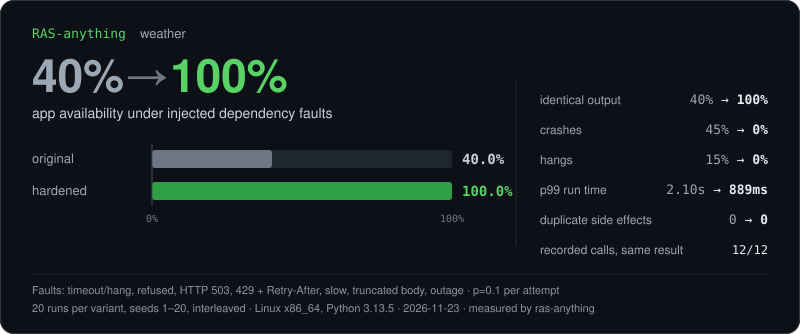

# weather: app availability under faults 40.0% → 100.0%

`python app.py`, 20 whole-app runs per variant (seeds 1–20, original and hardened interleaved, same fault seed per pair), faults injected live at the dependency boundary with p=0.1 per attempt.

| whole app | original | hardened |
|---|---:|---:|
| availability (exit 0, output correct or declared-degraded) | 40.0% | **100.0%** |
| byte-identical output (strict) | 40.0% | 100.0% |
| crashes | 45.0% | 0.0% |
| hangs | 15.0% | 0.0% |
| wrong output | 0.0% | 0.0% |
| duplicate non-idempotent side effects | 0 | 0 |
| p50 / p99 run time | 94ms / 2.10s | 338ms / 1.04s |
| faults injected (total) | 14 | 49 |

A run counts as *degraded* when its output differs only where a hardened function returned its declared `RAS_FALLBACK` in that run (originals declare none, so their differing output counts as wrong) or on lines containing `unavailable`.

- original crashes/hangs: URLError in weather.fetch_forecast ×6, hang in weather.fetch_forecast ×3, JSONDecodeError in weather.fetch_forecast ×2, HTTPError in weather.fetch_forecast ×1

## Verified functions

Each hardened function was replayed on its recorded real calls (dependency answers from the recording, no network, virtual clock), then under the fault matrix below, next to the original.

| function | happy path | availability under faults | wrong | hangs | p99 (budget) | dup side effects | verdict |
|---|---|---|---|---|---|---|---|
| `weather.fetch_forecast` | 12/12 identical | 32.5% → **100.0%** | 0 → 0 | 15 → 0 | 60.00s → 3.60s (5.00s) | 0 → 0 | ✓ pass |

## Fault model

| fault | effect at the boundary |
|---|---|
| `timeout` | no answer: caller's timeout fires; with no timeout it hangs (POST/PUT still reach the server) |
| `refused` | connection refused |
| `http5xx` | HTTP 503 (subprocess: exit 75 EX_TEMPFAIL) |
| `http429` | HTTP 429 with Retry-After: 1 |
| `slow` | +3 s latency, then the correct answer |
| `truncated` | body (or stdout) cut in half |
| `outage` | dependency down (refused) for 3 consecutive attempts, then recovers |
| `mixed` | seeded mix: each attempt faults with p=0.3, kind drawn uniformly |

Whole-app bench: each dependency attempt draws its fault from a hash of (seed, request, attempt number), so original and hardened see the same fault on the same attempt. Outages hit 5% of requests. Injected waits are scaled ×0.05 in real time and a call with no timeout is declared hung after 2s; the real local upstream answers everything else.

Host: Linux 6.12.113+ x86_64, 8 CPUs, Python 3.13.5 · 2026-11-23T04:14:16+0800

Undo: `ras-anything disable <id>` removes the swap byte for byte; `RAS_ANYTHING_DISABLE=1` runs the originals.

Made with ras-anything · design inspired by [fast-anything](https://github.com/EL4CTEO/fast-anything) (MIT)
